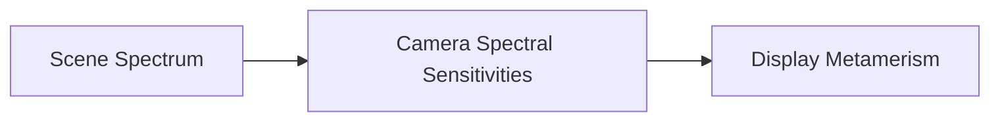

# Howto

---

## Astro Core Concepts for Beginners

### 1. Astro Component Anatomy (`.astro`)
Astro components have two parts separated by code fences (`---`):
```astro
---
// 1. Component Script (Frontmatter)
// Runs on the SERVER / BUILD-TIME only in Node.js.
// Import components, fetch data, read files, set variables.
import BaseLayout from '../layouts/BaseLayout.astro';
const title = "Hello World";
---

<!-- 2. Component Template (HTML + JSX-like expressions) -->
<BaseLayout title={title}>
  <h1>{title}</h1>
  <p>This renders to pure, fast static HTML with zero client JS overhead.</p>
</BaseLayout>
```

### 2. Static Routing (`src/pages/`)
Any file in `src/pages/` automatically becomes a route on your site:
- `src/pages/index.astro` &rarr; `/`
- `src/pages/publications/index.astro` &rarr; `/publications`
- `src/pages/folklore/[slug].astro` &rarr; `/folklore/:slug` (dynamic route generated with `getStaticPaths()`)

### 3. Static Assets: `public/` vs `src/`
- Files in **`public/`** are served directly at the root URL unchanged:
  - File: `public/pubs/my-paper.pdf` &rarr; URL: `/pubs/my-paper.pdf`
  - File: `public/images/figure.png` &rarr; URL: `/images/figure.png`
- Use `public/` for downloads, PDFs, raw 3D models, and external media.

### 4. Structured Data (`src/data/publications.ts`)
Rather than scattered markdown files, all academic publications live in a typed TypeScript structure with automatic DOI links, author highlights, and sorting.

---

## Exercise: Adding a PDF & Thumbnail to a Publication

Here is how to attach a downloadable PDF and a thumbnail preview to the **Phillips, Simion, Long, et al.** paper:

### Step 1: Place your PDF and Image in `public/pubs/`
Copy your PDF and thumbnail image into the `public/pubs/` directory:
- PDF path: `public/pubs/Simion2026-SpectralRendering.pdf`
- Image path: `public/pubs/Simion2026-thumb.jpg` (or `.png`)

> **URL Rule**: Because these files are inside `public/`, their web URLs start with `/pubs/`:
> - `/pubs/Simion2026-SpectralRendering.pdf`
> - `/pubs/Simion2026-thumb.jpg`

### Step 2: Open `src/data/publications.ts`
Find the publication entry (near line 21). It currently looks like this:

```typescript
  // 2026
  {
    id: "spectral-rendering-virtual-production-2026",
    year: 2026,
    title: "Spectral rendering techniques to improve color matching in virtual production",
    authors: ["V Simion", "S Farnand", "DL Long", "F Phillips"],
    venue: "SMPTE Motion Imaging Journal",
    volume: "135",
    issue: "6",
    type: "journal",
    typeLabel: "Journal Article",
    highlight: true
  },
```

### Step 3: Add the `pdf` and `image` Fields
Add the `pdf` and `image` properties to the object:

```typescript
  // 2026
  {
    id: "spectral-rendering-virtual-production-2026",
    year: 2026,
    title: "Spectral rendering techniques to improve color matching in virtual production",
    authors: ["V Simion", "S Farnand", "DL Long", "F Phillips"],
    venue: "SMPTE Motion Imaging Journal",
    volume: "135",
    issue: "6",
    type: "journal",
    typeLabel: "Journal Article",
    highlight: true,
    pdf: "/pubs/Simion2026-SpectralRendering.pdf",
    image: "/pubs/Simion2026-thumb.jpg"
  },
```

### Step 4: Preview Your Changes
Start the development server (or check your existing session):
```bash
npm run dev
```
Navigate to **`http://localhost:4321/publications`**:
1. The **"📄 PDF"** button will now be active (instead of the italicized request notice).
2. A responsive **thumbnail preview** will appear alongside the citation card.
3. If `highlight: true` is set, the paper also appears on the homepage under Selected Publications!

---

## Special Features

### URL Redirects (`astro.config.mjs` & `public/_redirects`)
When Blog and Folklore were merged, URL redirects were added so existing bookmarks and links don't break:
- `/blog` &rarr; `/folklore`
- `/blog/[slug]` &rarr; `/folklore/[slug]`
- `/bloggery` &rarr; `/folklore`
- `/bloggery/[slug]` &rarr; `/folklore/[slug]`

In local development and build output, Astro generates canonical redirect pages automatically. In production, Cloudflare Pages uses `public/_redirects` for instant HTTP 301 edge redirects.

### KaTeX Math Support
Render inline math with `$E = mc^2$` or block math with:
```markdown
$$
\int_{-\infty}^{\infty} e^{-x^2} dx = \sqrt{\pi}
$$
```

### Mermaid Diagrams
Fenced code blocks with language `mermaid` are rendered dynamically via Mermaid:
```markdown

```

### Three.js 3D Viewer (`ModelViewer3D.astro`)
Renders interactive 3D WebGL models (e.g. Gibson Feelies `.glb` or `.obj` files in `public/models/`) with orbit controls, lighting, and shadow casting.

---

## Helpful Documentation & Links

- **Astro Official Docs**: [https://docs.astro.build](https://docs.astro.build)
- **Astro Routing & Dynamic Routes**: [https://docs.astro.build/en/guides/routing/](https://docs.astro.build/en/guides/routing/)
- **Astro Content Layer & Collections**: [https://docs.astro.build/en/guides/content-collections/](https://docs.astro.build/en/guides/content-collections/)
- **Tailwind CSS v4 Documentation**: [https://tailwindcss.com/docs](https://tailwindcss.com/docs)
- **Cloudflare Pages Static Assets**: [https://developers.cloudflare.com/pages/](https://developers.cloudflare.com/pages/)

