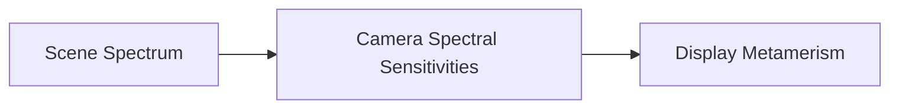

# Howto & Content Workflows

---

## Running Tools in VS Code (Menu & Tasks)

You do **not** need to memorize or type shell commands in the terminal. All authoring and maintenance tools are configured as standard VS Code Tasks:

### How to Access:
1. In the top macOS menu, click **Terminal &rarr; Run Task...**
   *(Or press `Cmd+Shift+P` and type `Tasks: Run Task`)*
2. Select any task from the dropdown list:

| VS Code Task Label | Description |
| :--- | :--- |
| **`Astro: Start Dev Server`** | Launches local dev server at `http://localhost:4321` with instant hot-reloading |
| **`Astro: Build Site`** | Full production build into `./dist` + builds Pagefind search index |
| **`Astro: Preview Build`** | Inspects the compiled static `./dist` files locally before deploying |
| **`Astro: New Post / Folklore Story`** | Interactively scaffolds a new Folklore story or Dispatch in `src/content/posts/` |
| **`Astro: Add Publication (via DOI)`** | Fetches publication metadata by DOI and adds to `src/data/publications.ts` |
| **`Astro: Check Image Sizes (Dry Run)`** | Scans `public/images/` and reports oversized photos & potential space savings |
| **`Astro: Optimize Images (In-Place)`** | Safely resizes & compresses backlog photos down to 2,048px retina masters |
| **`Astro: Build Search Index (Pagefind)`**| Re-indexes site content so local dev search is fresh |

---

## Quick Authoring Workflows

### 1. Adding a Folklore / Dispatch Post
Run via **Terminal &rarr; Run Task... &rarr; Astro: New Post** or in terminal:
```bash
npm run new:post
# or pass the title directly:
npm run new:post "Your Story Title"
```
* **Smart Ingest & Thumbnails:**
  * **Drag and drop** any image file (`.png`, `.jpg`, `.jpeg`, `.webp`, or even Apple `.heic`) from Finder directly into the terminal prompt!
  * **Automatic Conformer:** The ingest pipeline automatically:
    1. Reads orientation tags and **auto-rotates EXIF** (so iPhone photos are never sideways).
    2. Converts Apple `.heic` / `.heif` to universal web `.jpg`.
    3. Capped to **2,048px** max dimension (retina 5K display quality).
    4. Compresses with **MozJPEG Quality 85** (reducing a 12 MB camera photo to ~300 KB in ~100ms).
    5. Sanitizes filenames (slugifies spaces and special characters into clean web URLs).
  * Or type a filename already in `public/images/` (e.g. `my-photo.jpg`).
  * Or press Enter to skip—if skipped, the folklore archive will automatically pick up the first `` picture embedded in your story!

### 2. Adding an Academic Publication (with PDF & Thumbnail)
Run via **Terminal &rarr; Run Task... &rarr; Astro: Add Publication** or in terminal:
```bash
npm run new:pub <DOI>
# Example:
npm run new:pub 10.1145/3799829.3812522
# or run interactively:
npm run new:pub
```
* **Smart Asset Ingest:**
  * When prompted for the PDF, **drag and drop your PDF from Finder** (e.g. from Downloads/Desktop) directly into the terminal! The script copies it into `public/pubs/` and wires up `pdf: "/pubs/..."`.
  * When prompted for the thumbnail, **drag and drop your teaser image from Finder**! The script automatically conforms and optimizes the image, copies it to `public/pubs/`, and sets `image: "/pubs/..."`.
  * Prompts: `Highlight on homepage / Selected Works? (y/N):` &rarr; Answering `y` adds the amber `✦ Selected Work` badge and features it on the homepage!

### 3. Image Conformer & Optimizer Deep Dive
```bash
# Check image sizes and potential savings without modifying anything (Dry Run):
npm run images:check

# Safely conform and resize oversized backlog images in-place:
npm run images:optimize
```

#### Why 2,048px?
* On the web, content columns rarely exceed 800px wide, and full-width desktop viewports max out at 1,200px – 1,440px.
* For ultra-sharp high-DPI (2x retina) rendering on 5K Apple Studio Displays, the maximum pixel dimension ever required is **2,048px**.
* A raw 6,000 × 4,000 camera export is **13.0 MB**. Conforming it to 2,048px at Quality 85 reduces it to **~300 KB** (a **97% bandwidth and memory reduction**) while appearing visually identical on any display.

#### Safety & Integrity Guarantees:
* **Preserves exact filenames and relative paths**: Images are conformed in-place, so **zero Markdown links or URLs break**.
* **Skipped if already optimal**: Files under 400 KB and $\le$ 2,048px are skipped to avoid recompressing already optimized assets.
* **Non-image files protected**: PDFs uploaded to `public/images/uploads/` (e.g. poster sessions, slides) are recognized and never touched.
* **Size gate**: If conforming an image ever results in a larger file (rare, but can happen on tiny icons), the original file is preserved.

### 4. Global Search (`/search` or `Cmd+K`)
* The site includes instant, full-text client-side search powered by **Pagefind**.
* **Shortcut:** Press **`Cmd+K`** (or `Ctrl+K`) anywhere on the site to jump straight to search.
* **Build Indexing:** Search is automatically built during `npm run build`. You can also re-index locally via `npm run pagefind`.

---

## Astro Core Concepts for Beginners

### 1. Astro Component Anatomy (`.astro`)
Astro components have two parts separated by code fences (`---`):
```astro
---
// 1. Component Script (Frontmatter)
// Runs on the SERVER / BUILD-TIME only in Node.js.
// Import components, fetch data, read files, set variables.
import BaseLayout from '../layouts/BaseLayout.astro';
const title = "Hello World";
---

<!-- 2. Component Template (HTML + JSX-like expressions) -->
<BaseLayout title={title}>
  <h1>{title}</h1>
  <p>This renders to pure, fast static HTML with zero client JS overhead.</p>
</BaseLayout>
```

### 2. Static Routing (`src/pages/`)
Any file in `src/pages/` automatically becomes a route on your site:
- `src/pages/index.astro` &rarr; `/`
- `src/pages/publications/index.astro` &rarr; `/publications`
- `src/pages/folklore/[slug].astro` &rarr; `/folklore/:slug` (dynamic route generated with `getStaticPaths()`)

### 3. Static Assets: `public/` vs `src/`
- Files in **`public/`** are served directly at the root URL unchanged:
  - File: `public/pubs/my-paper.pdf` &rarr; URL: `/pubs/my-paper.pdf`
  - File: `public/images/figure.png` &rarr; URL: `/images/figure.png`
- Use `public/` for downloads, PDFs, raw 3D models, and external media.

### 4. Structured Data (`src/data/publications.ts`)
Rather than scattered markdown files, all academic publications live in a typed TypeScript structure with automatic DOI links, author highlights, and sorting.

---

## Exercise: Adding a PDF & Thumbnail to a Publication

Here is how to attach a downloadable PDF and a thumbnail preview to the **Phillips, Simion, Long, et al.** paper:

### Step 1: Place your PDF and Image in `public/pubs/`
Copy your PDF and thumbnail image into the `public/pubs/` directory:
- PDF path: `public/pubs/Simion2026-SpectralRendering.pdf`
- Image path: `public/pubs/Simion2026-thumb.jpg` (or `.png`)

> **URL Rule**: Because these files are inside `public/`, their web URLs start with `/pubs/`:
> - `/pubs/Simion2026-SpectralRendering.pdf`
> - `/pubs/Simion2026-thumb.jpg`

### Step 2: Open `src/data/publications.ts`
Find the publication entry (near line 21). It currently looks like this:

```typescript
  // 2026
  {
    id: "spectral-rendering-virtual-production-2026",
    year: 2026,
    title: "Spectral rendering techniques to improve color matching in virtual production",
    authors: ["V Simion", "S Farnand", "DL Long", "F Phillips"],
    venue: "SMPTE Motion Imaging Journal",
    volume: "135",
    issue: "6",
    type: "journal",
    typeLabel: "Journal Article",
    highlight: true
  },
```

### Step 3: Add the `pdf` and `image` Fields
Add the `pdf` and `image` properties to the object:

```typescript
  // 2026
  {
    id: "spectral-rendering-virtual-production-2026",
    year: 2026,
    title: "Spectral rendering techniques to improve color matching in virtual production",
    authors: ["V Simion", "S Farnand", "DL Long", "F Phillips"],
    venue: "SMPTE Motion Imaging Journal",
    volume: "135",
    issue: "6",
    type: "journal",
    typeLabel: "Journal Article",
    highlight: true,
    pdf: "/pubs/Simion2026-SpectralRendering.pdf",
    image: "/pubs/Simion2026-thumb.jpg"
  },
```

### Step 4: Preview Your Changes
Start the development server (or check your existing session):
```bash
npm run dev
```
Navigate to **`http://localhost:4321/publications`**:
1. The **"📄 PDF"** button will now be active (instead of the italicized request notice).
2. A responsive **thumbnail preview** will appear alongside the citation card.
3. If `highlight: true` is set, the paper also appears on the homepage under Selected Publications!

---

## Special Features

### URL Redirects (`astro.config.mjs` & `public/_redirects`)
When Blog and Folklore were merged, URL redirects were added so existing bookmarks and links don't break:
- `/blog` &rarr; `/folklore`
- `/blog/[slug]` &rarr; `/folklore/[slug]`
- `/bloggery` &rarr; `/folklore`
- `/bloggery/[slug]` &rarr; `/folklore/[slug]`

In local development and build output, Astro generates canonical redirect pages automatically. In production, Cloudflare Pages uses `public/_redirects` for instant HTTP 301 edge redirects.

### KaTeX Math Support
Render inline math with `$E = mc^2$` or block math with:
```markdown
$$
\int_{-\infty}^{\infty} e^{-x^2} dx = \sqrt{\pi}
$$
```

### Mermaid Diagrams
Fenced code blocks with language `mermaid` are rendered dynamically via Mermaid:
```markdown

```

### Three.js 3D Viewer (`ModelViewer3D.astro`)
Renders interactive 3D WebGL models (e.g. Gibson Feelies `.glb` or `.obj` files in `public/models/`) with orbit controls, lighting, and shadow casting.

---

## Helpful Documentation & Links

- **Astro Official Docs**: [https://docs.astro.build](https://docs.astro.build)
- **Astro Routing & Dynamic Routes**: [https://docs.astro.build/en/guides/routing/](https://docs.astro.build/en/guides/routing/)
- **Astro Content Layer & Collections**: [https://docs.astro.build/en/guides/content-collections/](https://docs.astro.build/en/guides/content-collections/)
- **Tailwind CSS v4 Documentation**: [https://tailwindcss.com/docs](https://tailwindcss.com/docs)
- **Cloudflare Pages Static Assets**: [https://developers.cloudflare.com/pages/](https://developers.cloudflare.com/pages/)

