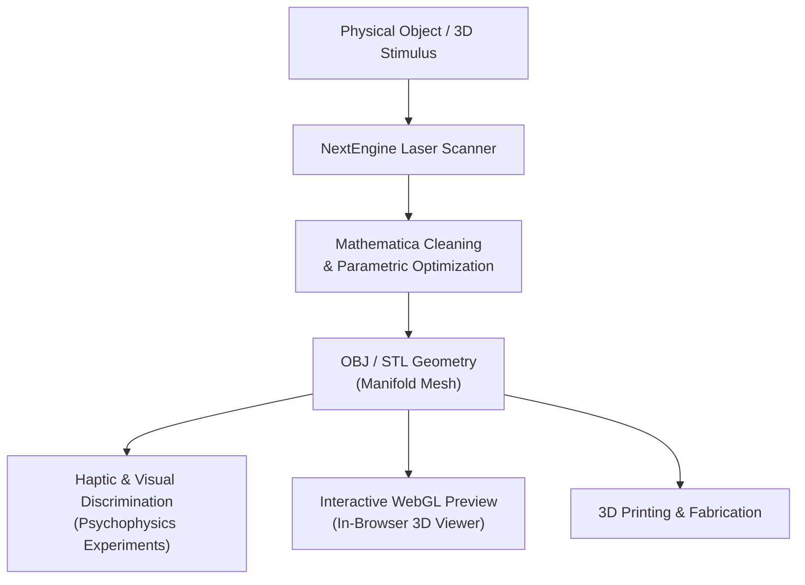
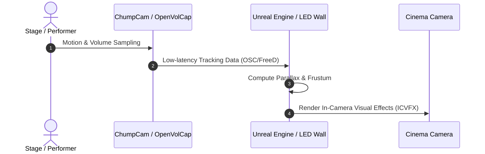

# Mathematical Equations & Mermaid Diagrams

A demonstration showing that Astro handles LaTeX mathematics (via server-rendered KaTeX) and interactive Mermaid diagrams with zero layout shift and full dark/light theme awareness.

---

## 1. Differential Geometry of Surfaces (Koenderink Metrics)

In computational vision and shape perception, 3D surface curvature is locally characterized by the principal curvatures $\kappa_1$ and $\kappa_2$. The Gaussian curvature $K$ and Mean curvature $H$ are given by:

$$K = \kappa_1 \kappa_2 \quad \text{and} \quad H = \frac{\kappa_1 + \kappa_2}{2}$$

Koenderink and van Doorn decouple surface *shape* from *scale* using the **Shape Index** $S \in [-1, 1]$ and **Curvedness** $C > 0$:

$$S = -\frac{2}{\pi} \arctan \left( \frac{\kappa_1 + \kappa_2}{\kappa_1 - \kappa_2} \right), \qquad (\kappa_1 \ge \kappa_2)$$

$$C = \sqrt{\frac{\kappa_1^2 + \kappa_2^2}{2}}$$

Notice how KaTeX renders these equations instantly on the server without any web font jitter, matching the exact styling of academic papers.

---

## 2. Bidirectional Reflectance Distribution Function (BRDF)

For material perception, the radiance $L_r(\mathbf{x}, \omega_r)$ reflected at surface point $\mathbf{x}$ in direction $\omega_r$ is governed by the rendering equation:

$$L_r(\mathbf{x}, \omega_r) = L_e(\mathbf{x}, \omega_r) + \int_{\Omega} f_r(\mathbf{x}, \omega_i, \omega_r) \, L_i(\mathbf{x}, \omega_i) \, (\omega_i \cdot \mathbf{n}) \, d\omega_i$$

---

## 3. Interactive Mermaid Diagrams

You can write standard ```` ```mermaid ```` markdown blocks, and Astro renders them as vector SVGs that adapt automatically to light or dark mode:



### Virtual Production Camera Tracking Pipeline



> **Why this gives you the best of both Quarto and Astro:**
> Because the content files are plain Markdown, every formula and diagram written in this format is 100% compatible with both **Astro** and **Quarto**. But with Astro, you get the additional benefit of full design freedom, custom components (like the 3D laser-scan viewer on the homepage), and zero runtime bloat.
